<a href="https://leovanni.dev/">
  <picture>
    <source media="(prefers-color-scheme: dark)" srcset="./art/hero-dark.svg">
    
  </picture>
</a>

 

<a href="https://leovanni.dev/"><picture><source media="(prefers-color-scheme: dark)" srcset="./art/pill-portfolio-dark.svg"></picture></a> &nbsp; <a href="https://www.linkedin.com/in/leonardo-vanni-bonavigo-6a387020b/"><picture><source media="(prefers-color-scheme: dark)" srcset="./art/pill-linkedin-dark.svg"></picture></a> &nbsp; <a href="https://instagram.com/leonardobonavigo"><picture><source media="(prefers-color-scheme: dark)" srcset="./art/pill-instagram-dark.svg"></picture></a>

 

<a href="https://leovanni.dev/">
  <picture>
    <source media="(prefers-color-scheme: dark)" srcset="./art/work-dark.svg">
    
  </picture>
</a>

 

<picture>
  <source media="(prefers-color-scheme: dark)" srcset="./art/architecture-dark.svg">
  
</picture>

 

<picture>
  <source media="(prefers-color-scheme: dark)" srcset="./art/profile-dark.svg">
  
</picture>

 

<picture>
  <source media="(prefers-color-scheme: dark)" srcset="./art/numbers-dark.svg">
  
</picture>

 

<picture>
  <source media="(prefers-color-scheme: dark)" srcset="./art/activity-dark.svg">
  
</picture>

 

<picture>
  <source media="(prefers-color-scheme: dark)" srcset="./art/languages-dark.svg">
  
</picture>

 

<picture>
  <source media="(prefers-color-scheme: dark)" srcset="./art/skyline-dark.svg">
  
</picture>

 

<picture>
  <source media="(prefers-color-scheme: dark)" srcset="./art/flap-dark.svg">
  
</picture>

